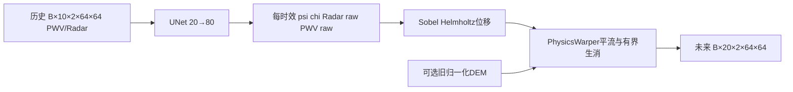

# Radar–PWV物理临近预报：version1.0历史代码发布整理
面向组内协作的历史物理模型：10帧Radar/PWV→UNet预测80通道→隐式运动/平流/生消→未来20帧。This is an audited historical physics baseline, not an ERA5 or diffusion implementation.



## 范围与结构
src/legacy/保留五份源文件原字节及原计算；src/physics_api.py提供轻量调用；scripts/是路径/资产保护包装；configs/只将路径可配置化，历史超参数是审计记录，不是可随意覆盖配置；docs/详述公式/数据/缺陷/协作。未实现ERA5、残差风场、T1/V2/PROVISIONAL或扩散融合。后期修复没有混入。

## 快速开始（CPU合成示例）
建议Python3.10，先按硬件安装匹配的torch/torchvision，再执行：
```bash
python -m pip install -r requirements.txt
python -B examples/synthetic_forward.py
python -B -m unittest discover -s tests -v
```
精确本机测试版本见docs/environment_tested.json，未宣称这是历史训练环境锁定文件。合成示例显式平地DEM/随机权重，不代表预测性能。

## 实际数据与推理
参见data/README.md；数据/DEM/权重不随仓库分发。输入.npy为float32 [B,10,2,64,64]、[0,1]，通道PWV、Radar：
```bash
python scripts/infer.py --input data/history.npy --dem data/dem_64x64.pt --checkpoint data/selected_model.pth --output runs/inference/prediction.npz
```
这是真实存在的入口，但缺少真实权重时仅参数解析经过测试，完整训练权重推理BLOCKED。输出六个命名张量见接口文档。

## 原训练/评价
复制configs/paths.example.json为私有路径配置，给每个阶段独立空output_dir。默认只预检，不训练：
```bash
python scripts/run_legacy.py --stage phase1 --config configs/paths.example.json
python scripts/run_legacy.py --stage phase1 --config configs/paths.example.json --execute
python scripts/run_legacy.py --stage phase2 --config configs/paths.example.json --execute
python scripts/run_legacy.py --stage evaluate --config configs/paths.example.json --execute
```
逐条按需执行；Phase2的checkpoint路径应指向Phase1最佳权重，evaluate应指向选定GAN权重，output_dir每次新建。缺数据/DEM/权重明确拒绝；不自动下载/长训。历史脚本仍用FP16 CUDA和原损失/门控，未做数值修复；正式训练与历史指标未复现。

## 必须了解的限制
旧dataset不解析时间、不检查6分钟连续性；跨缺帧窗口与分区重叠风险存在。训练stride10、测试stride5，使原70/15/15索引划分并非同一固定协议。test.py的随机权重回退与最后轮best_gan命名不适合科学选模；包装入口已在路径层阻止缺权重评价，但未重写原脚本。MSE/SSIM归一化及P1/P2目标不一致保留并列入审计，不能把本仓库误认为云端稳定修复版。
阈值是Z=200R^1.6转换的雷达等效雨强mm/h，不是独立实测降雨；旧CSI是逐样本均值，不是micro CSI。地形/位移在归一化像素单位，不能声称米制地形抬升或真实m/s风场。

## 扩散协作与详细文档
优先将冻结物理预测作为条件，双方先对齐张量与清单，不在本轮实现融合。见[扩散对接](docs/diffusion_integration.md)、[架构](docs/architecture.md)、[物理机制](docs/physics_model.md)、[数据](docs/data_format.md)、[训练评价](docs/training_evaluation.md)、[文件索引](docs/code_reference.md)、[代码审计](docs/code_audit_report.md)、[复现范围](docs/reproducibility.md)、[发布检查](docs/release_validation.md)。
项目未指定开源许可证，公开发布前需维护人确认源码/数据/权重授权，见NOTICE.md。没有自动创建GitHub仓库或推送。
